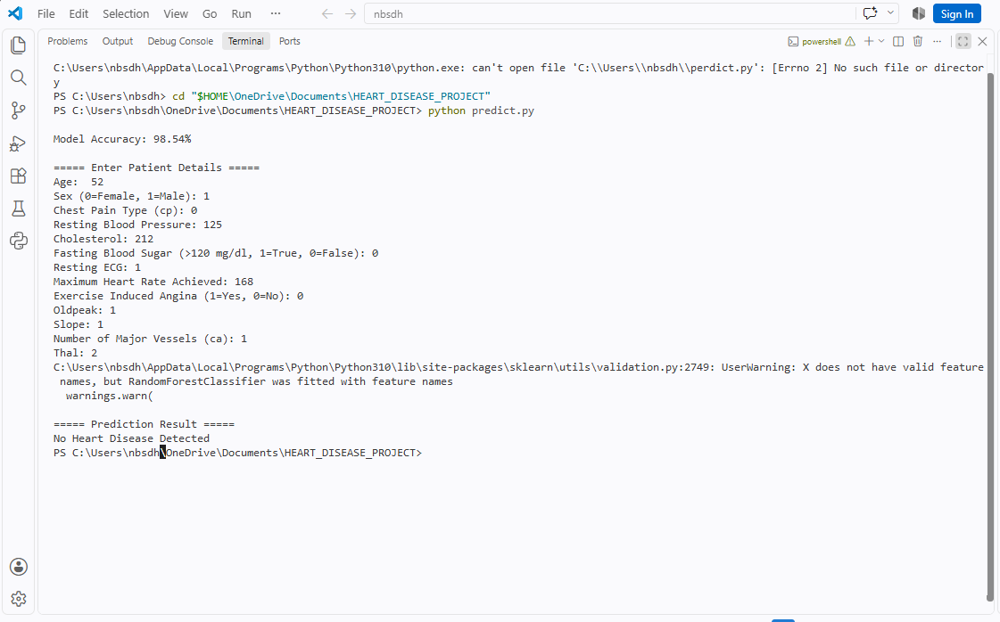

Intelligent Heart Disease Detection System

Project Overview

The Intelligent Heart Disease Detection System is a Python-based Machine Learning project that predicts the possibility of heart disease using patient medical data.

The system uses the Random Forest Classifier algorithm to analyze medical parameters and generate prediction results.

Objectives

- Collect and analyze heart disease datasets.
- Preprocess medical data.
- Perform feature selection and engineering.
- Train a Random Forest classification model.
- Evaluate model performance.
- Predict the possibility of heart disease.

Technologies Used

- Programming Language: Python
- Machine Learning Algorithm: Random Forest Classifier
- Libraries: Pandas, NumPy, Scikit-learn
- Dataset: Heart Disease Dataset (CSV)
- Interface: Console-based application

Project Modules

1. Data Collection Module
2. Data Preprocessing Module
3. Feature Engineering Module
4. Model Training Module
5. Prediction Module

Key Features

- Patient medical data analysis.
- Data cleaning and preprocessing.
- Machine Learning-based prediction.
- Random Forest classification.
- Console-based prediction results.

Input Parameters

- Age
- Blood Pressure
- Cholesterol
- Chest Pain Type
- Resting ECG
- Maximum Heart Rate
- Other clinical parameters

Model Performance

The internship report records a model accuracy of approximately 98.54%.

Project Type

Academic Internship Project

Disclaimer

This project is developed for educational purposes only. Its predictions are not a substitute for professional medical diagnosis.

Author

Dhanush N

B.Sc Computer Science
Kongunadu Arts and Science College

Conclusion

This project demonstrates the application of Python and Machine Learning techniques in healthcare data analysis and heart disease prediction.

## Project Screenshots

### 1. Project Folder

### 2. Python Code - Section 1

### 3. Python Code - Section 2

### 4. Model Output

